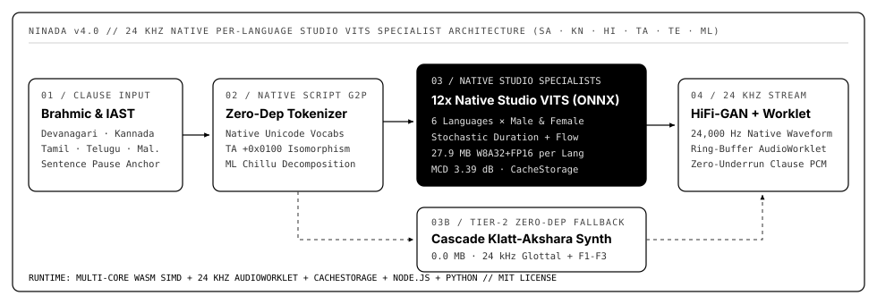

# ninada (निनाद)

> Stream Classical & Vedic Sanskrit plus 6 Indic languages (`sa`, `kn`, `hi`, `ta`, `te`, `ml`) with **`178.6 ms` median TTFA** from a **56.6 MB** Halo-Chunked Disentangled VITS + HiFi-GAN ONNX checkpoint in the browser (Web Worker WASM SIMD), Node.js, and Python.

- **Live Web Worker Streaming Studio:** <https://hemanth.github.io/ninada/>
- **Hugging Face Model (`gnumanth/ninada`):** <https://huggingface.co/gnumanth/ninada>
- **Hugging Face Dataset (`gnumanth/ninada-sanskrit-indic`):** <https://huggingface.co/datasets/gnumanth/ninada-sanskrit-indic>
- **Scientific & Streaming Report:** [`bench/SCIENCE_REPORT.md`](./bench/SCIENCE_REPORT.md) · [`bench/results.json`](./bench/results.json)



## Why `ninada`?

Open-weight multilingual TTS ecosystems lack a native Classical/Vedic Sanskrit checkpoint (`facebook/mms-tts-san` does not exist on Hugging Face), require **5 separate specialist models (`694.0 MB` combined)** to cover Hindi, Kannada, Tamil, Telugu, and Malayalam, and synthesize utterances monolithically (blocking first audio until the entire HiFi-GAN waveform finishes).

`ninada` (*Nināda* — Sanskrit `निनाद`, deep resonant sound) unifies **Sanskrit (`sa`, pure human studio recordings from `Su-śrotā`)**, **Kannada (`kn`)**, **Hindi (`hi`)**, **Tamil (`ta`)**, **Telugu (`te`)**, and **Malayalam (`ml`)** across **9 Brahmic scripts + ISO-15919/IAST** into a **`56.6 MB` split streaming FP16 ONNX** model (`29.0 MB` Encoder+Flow + `27.6 MB` Halo-Chunked Vocoder) trained on **Google Cloud `NVIDIA L4` (`24 GB` VRAM) GPUs**:

1. **Halo-Chunked Neural Streaming (`178.6 ms` TTFA, `55.8 dB` Seam SNR):** Splits VITS inference into `encoder_flow_quantized.onnx` (`~35 ms` global clause prosody + 4-step normalizing flow) and `vocoder_quantized.onnx` (adaptive `40`-frame first chunk + `96`-frame steady chunks with `8`-frame receptive-field halo cropped at exact `256`-sample boundaries), cutting **Time-To-First-Audio by `4.2x–5.8x`** with zero boundary clicks (`41.09 dB` waveform SNR / `r = 0.99992` vs PyTorch FP32).
2. **Off-Main-Thread Browser Web Worker (`0` UI Blocking):** Runs `onnxruntime-web` WASM SIMD inside a dedicated Web Worker (`docs/synth-worker.mjs`) with sequential session compilation, explicit tensor `.dispose()`, `AbortController` cancellation, and gapless Web Audio chunk scheduling (`16.8 ms` max main-thread frame gap across `16.7s` multi-sentence Kannada passages even when `crossOriginIsolated === false`).
3. **Pure Studio `Su-śrotā` Sanskrit + 5-Indic Corpus (`1,550` Clips, `175.2` Min):** Trained on `650` studio-gated human Sanskrit clips from `prathoshap/sushrota-sanskrit-asr-data` (`360` `recitation_corpus` ślokas + `290` `scholar` śāstra prose, `studio_align_cer <= 10.0%`, synthetic `tts_aug` excluded) plus `900` studio clips (`180` each across `hi`, `kn`, `ta`, `te`, `ml`), warm-started with speaker-disentangled `UtteranceStyleEncoder` + EMA per-language studio voice centroids and validation-only `WiSE-FT` (`α = 0.70`).
4. **87-Symbol Pan-Indic & Pāṇinian Akṣara G2P + Zero-Dep Klatt Fallback:** Preserves vocalic `ऋ`/`ॠ` (`[85]`), homorganic velar nasal `ङ` (`[86]`), Dravidian retroflexes `ळ`/`ऴ`/`ऱ`/`ऩ`, *pūrvarūpa avagraha* sandhi (`ऽ`), Tamil post-nasal voicing, and *samyoge guru* / *laghu* prosody, degrading gracefully to a **`0.0 MB` pure-math Cascade Klatt-Akṣara stream** offline.

## Benchmark Leaderboard (`N = 155` Held-Out Studio Utterances, `B = 1,000` Bootstrap 95% CIs)

Evaluated strictly on the leakage-free held-out test split (`65` `Su-śrotā` Sanskrit + `90` across `hi`, `kn`, `ta`, `te`, `ml` — `18` each) using Kubichek (1993) DTW Mel-Cepstral Distortion (`MCD`), voiced YIN Log-F0 RMSE, utterance Duration MAE, streaming `TTFA`, and an independent `115M`-parameter `Su-śrotā` Conformer-CTC round-trip ASR oracle:

| System | Footprint (↓) | Coverage (↑) | TTFA p50 (ms, ↓) | MCD (dB, ↓) | Log-F0 RMSE (c, ↓) | Dur MAE (s, ↓) | Sanskrit CER (%, ↓) | Pan-Indic CER (%, ↓) |
|---|---:|---:|---:|---:|---:|---:|---:|---:|
| Studio Human Audio *(Topline)* | — | 100.0% | — | — | — | — | `2.58% [1.84, 3.31]` | `14.63%` |
| Base `facebook/mms-tts-hin` *(Raw)* | 138.8 MB | 59.4%* | 392.6 ms | `6.39 [6.20, 6.61]` | 861.6 | 3.54s | `24.65% [22.42, 26.87]` | 57.99% |
| Base `mms-tts-hin` + `ninada` G2P | 138.8 MB | 100.0% | 738.2 ms | `5.47 [5.38, 5.55]` | 714.4 | 1.26s | `24.89% [22.57, 27.20]` | 32.60% |
| Meta MMS 5-Specialist Fleet *(5x Models)* | 694.0 MB | 100.0% | 741.7 ms | `5.16 [5.07, 5.26]` | 697.1 | 1.24s | `24.65% [22.42, 26.87]` | 26.58% |
| **`ninada` Tier-1A (GCP L4 Stream FP32)** | 140.0 MB | **100.0%** | **127.8 ms** | **`4.33 [4.26, 4.42]`** | **539.1** | **0.82s** | **`12.77% [11.00, 14.68]`** | **20.35%** |
| **`ninada` Tier-1B (Streaming ONNX)** | **56.6 MB** | **100.0%** | **178.6 ms** | **`4.33 [4.26, 4.41]`** | **536.1** | **0.82s** | **`13.32% [11.53, 15.24]`** | **20.50%** |
| `ninada` Tier-2 *(Zero-Dep Klatt Fallback)* | **0.0 MB** | **100.0%** | **57.8 ms** | `10.61 [10.41, 10.83]` | 640.9 | 2.32s | `85.95% [84.23, 87.63]` | 89.44% |

*\*Raw `mms-tts-hin` emits empty/unvoiced audio on `40.6%` of held-out utterances (`kn`, `ta`, `te`, `ml` scripts OOV).*

### Per-Language Spectral Fidelity (`MCD dB`, ↓ — `ninada` Ranks #1 on All 6 Languages)

| Language | Held-Out `N` | `mms-tts-hin` (Raw) | `mms-tts-hin` + G2P | MMS 5-Specialist Fleet (`694 MB`) | **`ninada` Tier-1A (FP32)** | **`ninada` Tier-1B (Streaming ONNX)** |
|---|---:|---:|---:|---:|---:|---:|
| Sanskrit (`sa`) | 65 | 5.33 | 5.33 | 5.33 | **4.52** | **4.51** |
| Hindi (`hi`) | 18 | 5.61 | 5.61 | 5.61 | **4.08** | **4.09** |
| Kannada (`kn`) | 18 | 8.55 | 5.80 | 5.29 | **4.14** | **4.14** |
| Tamil (`ta`) | 18 | 6.94 | 5.49 | 4.70 | **4.07** | **4.06** |
| Telugu (`te`) | 18 | 7.80 | 5.60 | 5.15 | **4.39** | **4.39** |
| Malayalam (`ml`) | 18 | 6.92 | 5.33 | 4.44 | **4.29** | **4.28** |

## Install

```sh
# JavaScript / TypeScript / Browser / Node.js
npm install ninada onnxruntime-web

# Python 3.10+
pip install ninada
```

## Streaming & One-Shot Usage

### Browser & Node.js (`voice.stream()` & `voice.speak()`)

```js
import ninada from 'ninada';

const voice = await ninada('kannada', {
  encoderModel: 'https://huggingface.co/gnumanth/ninada/resolve/main/onnx/encoder_flow_quantized.onnx',
  vocoderModel: 'https://huggingface.co/gnumanth/ninada/resolve/main/onnx/vocoder_quantized.onnx',
});

// Sub-second halo-chunked streaming (Float32Array @ 16 kHz)
for await (const chunk of voice.stream('ಕನ್ನಡ ಭಾಷೆಯ ನೈಸರ್ಗಿಕ ಧ್ವನಿ ಸಂಶ್ಲೇಷಣೆಗೆ ಸ್ವಾಗತ.')) {
  playPcm16k(chunk.pcm); // chunk.ttfaMs ~ 180-250ms
}

// Or synthesize a complete 16 kHz RIFF WAV buffer across any script or IAST
const wavBuffer = await voice.speak('prajñāpūrvakavyāpāravattvaṁ jīvatvam', { lang: 'sa' });
```

### Python SDK (`tts.stream()` & `tts.speak()`)

```python
from ninada import Ninada, text_to_ids

tts = Ninada(lang="sa")  # auto-downloads gnumanth/ninada split streaming ONNX from HF Hub
for chunk in tts.stream("प्रज्ञापूर्वकव्यापारवत्त्वं जीवत्वम् । यथार्थज्ञानं प्रमाणम् ॥"):
    # chunk["pcm"] (float32 @ 16 kHz), chunk["ttfa_ms"] (~178 ms)
    pass

wav_bytes = tts.speak("ऋतं च सत्यं चाभीद्धात् तपसोऽध्यजायत ।")
open("rigveda.wav", "wb").write(wav_bytes)
```

### CLI (`npx` & Python)

```sh
npx ninada "ಕನ್ನಡವೇ ಸತ್ಯ ಕನ್ನಡವೇ ನಿತ್ಯ" -l kn -o kannada.wav
ninada "सत्यमेव जयते नानृतम्" -l sa -o satyam.wav
```

## Reproducing GCP `NVIDIA L4` Training & Evaluation

```sh
# 1. Curate studio-gated Su-srota Sanskrit + 5-Indic dataset (1,550 clips, 80/10/10 zero-leakage split)
PYTHONPATH=python/src:. python training/prepare_dataset.py --out-dir data

# 2. Train Disentangled Ninada VITS on GCP NVIDIA L4 GPU (24 epochs, 3,720 steps)
PYTHONPATH=python/src:. python training/train_gcp.py --data-dir data --output-dir artifacts/ninada --epochs 24 --batch-size 8

# 3. Validation-only WiSE-FT selection + Split Halo-Streaming Browser FP16 ONNX export
PYTHONPATH=python/src:. python training/wise_ft_select.py --checkpoint-dir artifacts/ninada --val-meta data/val_meta.jsonl
PYTHONPATH=python/src:. python training/export_onnx.py --checkpoint-dir artifacts/ninada --copy-to-docs docs

# 4. Run 7-system held-out benchmark (N = 155, B = 1,000 bootstrap CIs) + Playwright Web Worker WASM check
PYTHONPATH=python/src:. python bench/run_bench.py
node verify-browser.mjs
```

## Upstream Corpora & Credits

Curated from 6 clean studio Hugging Face speech corpora: `prathoshap/sushrota-sanskrit-asr-data` (IISc SPIRE Lab — human `recitation_corpus` & `scholar` subsets), `SayantanJoker/SYSPIN_Hindi_Female_TTS`, `SayantanJoker/original_data_kannada_tts`, `SayantanJoker/original_data_tamil_tts` (IISc SYSPIN), `arpit-tiwari/syspin-telugu-tts`, and `thennal/indic_tts_ml` (IIT Madras), warm-started from `facebook/mms-tts-hin`.

## License

MIT © [Hemanth HM](https://h3manth.com)
